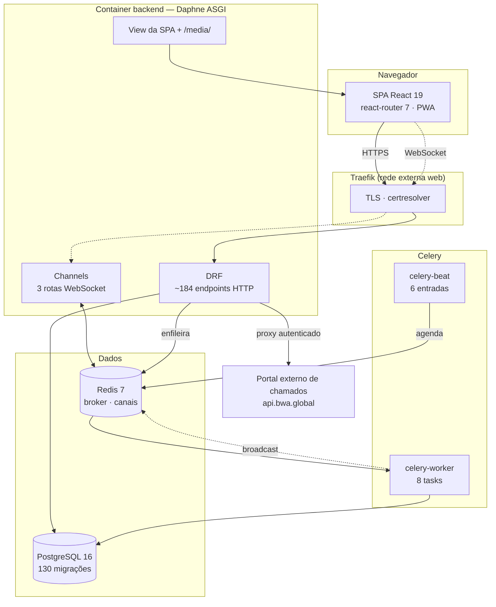

# BWA Tech — Documentação de Arquitetura

> **O que é este documento.** O mapa completo do BWA Tech: o que cada parte faz,
> como as partes se ligam, e — onde o código registrou — *por que* foi feito
> assim. Serve para quem vai mexer no sistema e precisa saber o que vai quebrar.
>
> **Como foi levantado.** Leitura direta do código-fonte por treze passes
> independentes, um por subsistema, mais um passe final que procurou justamente
> o que os outros doze não alcançariam. Nada aqui foi deduzido de nome de
> arquivo ou de convenção presumida. Onde não deu para confirmar, está escrito
> que não deu — [Riscos e lacunas](12-riscos-e-lacunas.md) lista tudo que ficou
> em aberto.
>
> **Escala do que foi mapeado.** 97 mil linhas (42,7k Python + 54k TypeScript),
> 9 apps Django, 130 migrações, 20 páginas e 75 componentes React.

---

## Índice

| Documento | O que tem dentro |
|---|---|
| **[Domínio e vocabulário](01-dominio.md)** | O que o sistema é, o vocabulário que engana (projeto é pasta) e onde cada coisa mora. |
| **[Modelo de dados](02-modelo-de-dados.md)** | 96 modelos catalogados, campo a campo, agrupados por app. |
| **[API HTTP e WebSocket](03-api-http.md)** | Todos os endpoints com método, rota, view, permissão e efeito. As três rotas WebSocket. |
| **[Autenticação e autorização](04-autenticacao-e-permissoes.md)** | Token de 24h, catálogo de 29 permissões, cargos como fonte de autoridade e o recorte por setor (hoje desligado). |
| **[Filas, agendamentos e tempo real](05-assincrono.md)** | Celery, Beat, signals e a política de payload dos eventos. |
| **[Banco de dados](06-banco-de-dados.md)** | 130 migrações, os seeds que o sistema espera encontrar, constraints e a política de on_delete. |
| **[Frontend](07-frontend.md)** | Rotas da SPA, contextos, camada de serviços, design system e tempo real no cliente. |
| **[Infraestrutura e deploy](08-infraestrutura.md)** | Docker, compose, Traefik, o pipeline de CI/CD e o desenvolvimento local. |
| **[Testes](09-testes.md)** | Onde há cobertura, onde não há, como rodar a suíte e a armadilha do --keepdb. |
| **[Decisões arquiteturais](10-decisoes.md)** | 366 decisões recuperadas dos comentários do código, com o porquê de cada uma. |
| **[Armadilhas](11-armadilhas.md)** | 230 pontos que mordem quem mexer sem saber. |
| **[Riscos e lacunas](12-riscos-e-lacunas.md)** | O que está em risco hoje, o que este mapeamento não confirmou, e onde procurar cada coisa. |

---

## Stack e versões

### Backend

| Peça | Versão | Papel |
|---|---|---|
| Django | 5.2.10 | framework, ORM, migrações |
| Django REST Framework | 3.16.1 | API HTTP, serialização, permissões |
| Channels | 4.0.0 | WebSocket (ASGI) |
| channels-redis | 4.2.0 | camada de canais entre processos |
| Daphne | 4.1.0 | servidor ASGI (primeiro em `INSTALLED_APPS`, para o `runserver` também ser ASGI) |
| Celery | 5.3.4 | fila de tarefas e agendador (Beat) |
| Redis | 5.0.1 (cliente) / 7.4 (servidor) | broker, result backend e camada de canais |
| PostgreSQL | 16.6 | banco em produção (SQLite em desenvolvimento) |
| psycopg2-binary | 2.9.11 | driver Postgres |
| django-cors-headers | 4.9.0 | CORS |
| django-filter | 24.3 | filtros de queryset |
| whitenoise[brotli] | 6.8.2 | arquivos estáticos |
| Pillow | 11.0.0 | imagens (foto de perfil) |
| WeasyPrint | 63.1 | relatórios em PDF |
| python-docx + htmldocx | 1.1.2 / 0.0.6 | relatórios em DOCX |
| openpyxl | 3.1.5 | relatórios e exportações em XLSX |
| requests | 2.32.3 | chamadas ao portal externo de chamados |

### Frontend

| Peça | Versão | Papel |
|---|---|---|
| React | 19.2 | interface |
| TypeScript + Vite | — / 7 | linguagem e build |
| react-router-dom | 7.13 | roteamento client-side, URLs em português |
| Tailwind CSS | v4 | estilo, configurado **em CSS** (`@theme`), sem `tailwind.config.js` |
| @dnd-kit | 6.3 / 10.0 | arrastar-e-soltar do Kanban |
| recharts | 3.7 | gráficos |
| framer-motion | 12.40 | animações (demo do login, notas de Meus Afazeres) |
| axios | 1.13 | cliente HTTP (três instâncias separadas) |
| lucide-react | 0.563 | ícones |
| class-variance-authority + tailwind-merge + clsx | — | variantes e composição de classe (`cn()`) |
| @radix-ui/react-tabs | 1.1 | **o único** Radix de fato usado; o resto do design system é reimplementação própria |
| xlsx | 0.18 | leitura/escrita de planilha no cliente |
| vite-plugin-pwa | — | PWA com `autoUpdate` |

### Infraestrutura

Imagem Docker única multi-stage (Vite builda o frontend; o estágio final é
Python 3.12 rodando Daphne como usuário não-root, UID 10001), orquestrada por
`docker-compose.yml` com quatro serviços: `db`, `redis`, `backend` e dois
processos Celery (`celery-worker` e `celery-beat`) que reaproveitam a mesma
imagem trocando o `command`. Exposição pública só via Traefik; as portas do
compose são todas bindadas em `127.0.0.1`.

---

---

## Mapa do sistema

### O caminho de uma mudança até a tela

Vale seguir um exemplo, porque ele explica a política de tempo real do sistema.
Alguém arrasta um card de coluna:

1. O front faz `PATCH` no card.
2. A view grava, e um **signal** dispara.
3. O signal publica no grupo do Channels — **sem os dados do card**.
4. O cliente recebe o aviso e **refaz a busca** pelo REST.

O evento ir vazio é deliberado e está documentado no código: quem decide o que
cada pessoa pode ver é o *queryset* recortado por setor, do lado do REST.
Repetir essa decisão no emissor do evento significa manter duas cópias da regra
de visibilidade — e foi exatamente esse o defeito que `formularios/realtime.py`
teve de desfazer. Eventos de **notificação** são a exceção: esses carregam o
objeto serializado, porque a notificação já nasce endereçada a uma pessoa.

---

---

## Como este documento foi levantado

Treze passes de leitura independentes sobre o código-fonte, um por subsistema,
mais um passe final cuja única tarefa era achar o que os outros doze não
alcançariam — management commands, scripts de operação, configuração de
ferramenta, documentação preexistente, a suíte de testes.

Cada passe devolveu dados estruturados (modelos, endpoints, fluxos, processos
assíncronos, decisões com o porquê, armadilhas e lacunas admitidas), e o
documento foi montado a partir deles. O que aparece aqui como decisão
arquitetural foi, na maioria dos casos, recuperado de comentários no próprio
código — é a parte que não se reconstrói lendo o código meses depois.

**Onde não deu para confirmar, está escrito que não deu.** A seção
[Riscos e lacunas](12-riscos-e-lacunas.md) lista tudo que ficou em aberto,
inclusive o que foi deliberadamente não inspecionado e por quê.

### Como manter isto vivo

O documento reflete o código no momento em que foi levantado. As partes que
envelhecem mais rápido são [Modelo de dados](02-modelo-de-dados.md) e
[API HTTP](03-api-http.md) — toda migração e todo endpoint novo as desatualiza.
As [Decisões arquiteturais](10-decisoes.md) e as [Armadilhas](11-armadilhas.md)
envelhecem devagar, e são as de maior valor: registram intenção, não estado.
